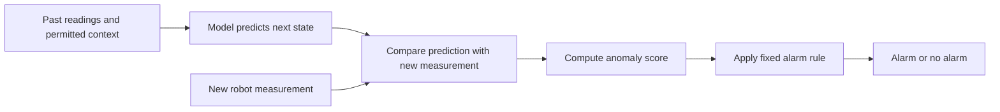

# Step 0 — Understand the manufacturing research before running models

Prepared 16 October 2026 for the manufacturing project. This lesson uses a **synthetic classroom robot example**. Its numbers, labels and timings are invented for teaching; they are not CASPER measurements or benchmark results. Preparing the lesson does not establish that a researcher has read or understood it. Use [YOUR_STEP_0_NOTES.md](YOUR_STEP_0_NOTES.md) for your own explanation.

## Start with one concrete problem

Imagine a robot repeatedly picking up a part and placing it elsewhere. A controller sends movement commands; sensors report motion. Our research asks whether a detector can recognize deviations under a clearly stated set of assumptions about which commands and sensors it can trust.

A deviation could come from a malicious command, a different legitimate job, a heavier part, wear, an impact, a sensor error or an inaccurate model. **Detecting something unusual does not establish why it happened.** Evaluating attack-detection performance requires documented attack ground truth and an appropriate threat model; the operating detector does not receive true attack labels. Manufacturing, predictive maintenance and cybersecurity overlap, but are not interchangeable tasks.

## 1. What a digital twin does

A digital twin represents an identified physical counterpart and its changing state. The broad concept includes representations of states and transitions; security also depends on the trustworthiness of the data and twin. [NIST IR 8356](https://csrc.nist.gov/pubs/ir/8356/final)

For our proposed detection study, we would specify the physical robot, the represented state, a model of its behavior, how observations update that state, and what the model predicts. A 3D picture is optional. A dashboard, simulator or classifier alone does not establish that those connections exist or are accurate. NIST's manufacturing example illustrates using physical observations together with a process twin for security monitoring. [NIST manufacturing explanation](https://www.nist.gov/news-events/news/2023/02/how-digital-twins-could-protect-manufacturers-cyberattacks)

Three operations are different:

| Operation | Classroom robot example |
|---|---|
| Update the estimated state | Estimate where the arm is now from the available observations. |
| Update the model parameters | Change a learned relationship describing how the arm responds to a command. |
| Update the alarm calibration | Change what size of prediction error counts as unusual. |

A model can keep fixed parameters while its estimated state changes every instant. “Fixed model” does not mean “stationary robot.” Updating any of these from compromised information can cause different problems; one generic “trust gate” does not automatically protect all of them.

In an offline study we can replay recorded observations in time order, exposing only information available up to each decision. That supports an offline evaluation. It does not demonstrate live robot deployment, secure sensors or prevention of damage.

## 2. What a baseline is

A **baseline method** is an existing approach we compare with under a specified protocol. A **baseline paper** describes an approach and its reported experiments; a **benchmark dataset** supplies observations for evaluation. These are three different things.

For example, compare a simple fixed alarm rule, an existing learned detector, and a proposed twin-based detector. The simple rule checks whether extra complexity is useful. The existing detector checks whether the proposed contribution improves on credible prior work. An **ablation** removes one part of our own method to test what that part contributes.

Comparisons must disclose data releases, channels, training labels, chronology, calibration and evaluation coverage. A detector given trustworthy external motion sensors is not receiving the same information as one using possibly compromised controller reports. Both may use files named CASPER yet answer different questions.

Our current learning candidates are CASPER, TWINE and CatBoost on CASPER. This is not a ranking or an approved numerical comparison. The [selection report](BASELINE_SELECTION_REPORT.md) records the evidence and unresolved issues. Author-code execution with a changed protocol is different from faithful reproduction; writing a method ourselves from a description is a reimplementation.

## 3. From expected motion to an anomaly score

For this **synthetic illustration only**, use one joint angle in degrees over a small range without angle wraparound. A full robot model would need more information.

Before the next reading arrives, the model predicts **30°**, using permitted past observations and command context. The observed angle is **34°**.

```text
Prediction:                 30°
Measurement:                34°
Residual = measurement − prediction = +4°
Score = absolute residual            = 4°
```

A **residual** is the discrepancy. An **anomaly score** summarizes evidence of unusual behavior. Here the score ignores the sign and measures the size of the discrepancy. Other methods might combine several residuals, prediction losses or classifier outputs.

The score **4° is not a 4% probability of attack**. Scores have model-dependent units and scales. A larger score means more suspicious only if that method defines it that way. Two methods' numerical scores cannot be compared directly without their definitions.



For this prediction-residual design, form the prediction before using the new measurement. For future adaptive experiments, record the score before allowing the sample to update the model. A method that examines a window ending now must still avoid future samples; its available history and score timestamp must be explicit.

## 4. A threshold turns a score into an alarm

A **threshold** is a decision boundary. Suppose we previously chose the following rule using separate eligible calibration data:

```text
Alarm when score > 3°.
```

The synthetic 4° score raises an alarm. It establishes that the reading exceeds this model's chosen tolerance, not that an attacker has been identified. At exactly 3° this particular rule does not alarm; equality handling must be documented.

For a fixed sequence of scores and this simple rule, lowering the threshold can add alarms; raising it can remove them. That usually creates a trade-off between missed anomalies and false alarms. Model retraining and complex alarm policies are separate changes; do not attribute all changes in behavior to a threshold.

We can choose an operating point from normal calibration scores and a predeclared false-alarm target. It is an estimate from that calibration period, not a guarantee of the future false-alarm rate. A persistent alarm may trigger hundreds of positive samples but only one operator notification, so point rates and alarm episodes must be reported separately.

## 5. How to tell whether alarms are useful

For the following **six synthetic points only**, the evaluator knows the labels. The detector computes scores from permitted observations; only the evaluator receives the hidden labels. These points are not claimed to be independent physical experiments or six separate attacks.

| Point | Score | Evaluator's synthetic label | Alarm at score > 3° | Outcome |
|---|---:|---|---|---|
| A | 1° | Normal | No | True negative |
| B | 4° | Normal | Yes | False positive: false alarm |
| C | 2° | Normal | No | True negative |
| D | 5° | Attack | Yes | True positive |
| E | 2.5° | Attack | No | False negative: miss |
| F | 6° | Attack | Yes | True positive |

There are two true positives (TP), one false positive (FP), one false negative (FN) and two true negatives (TN).

- **Precision:** among the alarms, how many are correct? TP/(TP+FP) = 2/3.
- **Recall:** among the attack-labelled points, how many are detected? TP/(TP+FN) = 2/3.
- **F1:** combines precision and recall; 2TP/(2TP+FP+FN) = 2/3.
- **False-positive rate:** among normal points, how many trigger alarms? FP/(FP+TN) = 1/3. It has a different denominator from precision.

We can change thresholds here because this is a classroom demonstration, not held-out experimental evaluation:

| Synthetic threshold | TP | FP | FN | TN | Precision | Recall |
|---|---:|---:|---:|---:|---:|---:|
| score > 1.5° | 3 | 2 | 0 | 1 | 3/5 | 3/3 |
| score > 3° | 2 | 1 | 1 | 2 | 2/3 | 2/3 |
| score > 5° | 1 | 0 | 2 | 3 | 1/1 | 1/3 |

High accuracy alone can be misleading: in an invented collection with 990 normal and 10 attack points, always saying “normal” yields 99% accuracy and detects zero attacks. Our real evaluation must also report false alarms, misses and timing.

An **event** is an interval, not a point. If an invented 20-second attack produces one alarm at second 15, event detection can count it as detected while most attack points were missed. Detection delay is 15 seconds under a stated onset convention. Missed events must remain visible; averaging delay only over detected attacks can conceal them. Do not silently count every point of an event as detected because one alarm occurred.

## 6. Data leakage: getting information the evaluation was meant to withhold

Data leakage happens when reserved or unavailable information influences model development or decisions. Training on test rows is one example, but selecting a threshold from final attack labels also leaks information even when model weights stay fixed. Security-ML research discusses such evaluation pitfalls. [Arp et al., USENIX Security 2022](https://www.usenix.org/conference/usenixsecurity22/presentation/arp)

For our chronological robot study, use separate roles:

| Data role | Permitted purpose |
|---|---|
| Training | Fit the allowed model and preprocessing, using only the label access permitted by the chosen track. |
| Development/validation | Select configurations on permitted development information. This is not the final test. |
| Normal calibration | Choose an alarm threshold or policy under a predeclared normal false-alarm target, after model selection. |
| Final test | Score the frozen procedure. Hidden labels are used by the evaluator to measure performance. |

These roles must be realized with actual disjoint time/run partitions; inventing four folder names does not create independence. Calibration need not reuse training rows. Fit preprocessing on training data and apply the learned transformation to later partitions. [scikit-learn's leakage guidance](https://scikit-learn.org/stable/common_pitfalls.html#data-leakage)

| Leakage or dependence problem | Why it matters here |
|---|---|
| Compute normalization statistics using all recordings | The model's transformation has learned about the held-out distribution. |
| Randomly split overlapping motion windows | Nearly identical measurements can appear in training and testing. Split independent episodes/time first, then build windows within partitions. |
| Use a centered rolling filter or future interpolation for a real-time alarm | The evaluated detector sees readings it would not yet possess. |
| Pick the threshold with the highest final-test F1 | Test attack answers helped choose the decision rule. |
| Include `Anomaly State`, a derived label or end-of-run summary as a current input | The model may receive the answer or information unavailable at alarm time. |
| Repeatedly inspect test failures and redesign the method | The final test becomes part of development. Report exploration honestly and seek untouched confirmation data. |

Random row splitting is not universally wrong for every statistical problem. It is inappropriate evidence for our proposed future-time robot evaluation when neighboring/correlated cycles cross partitions. Chronological order alone also does not remove duplicated runs or ensure independent attack scenarios.

## How this connects to our three papers

The [source audit](literature/COMPARATOR_SCREEN_2026-10-16.md) found best-F1 threshold selection in available CASPER code. The [TWINE audit](literature/TWIN_METHOD_SCREEN_2026-10-16.md) found random splits and distinct model/feature paths. Available CatBoost code constructs some synthetic outlier labels and fits scaling before splitting. These are reasons to inspect implementations, not proof that every reported paper result used those exact paths.

A research result must make clear what was actually reproduced and what we changed. A clean new comparison may be valuable, but correcting an evaluation does not by itself establish a novel digital-twin method.

## Your first practice task

Use [YOUR_STEP_0_NOTES.md](YOUR_STEP_0_NOTES.md). Explain, in your own words, the synthetic 30°/34° example; why two CASPER methods can receive unequal information; why final-test threshold tuning leaks; and why event recall differs from point recall and delay. The worked example above is an answer aid, not your completed response.

You do not need neural-network equations yet. First be able to follow **input → expected behavior → score → threshold → alarm → evaluation**, and identify which information each step is allowed to use.

Source scope: NIST supports broad twin/security context; Arp et al. and scikit-learn support evaluation/leakage background. Their dates do not make them new manufacturing baselines. All robot angles, miniature labels, threshold tables and timings in this lesson are original synthetic teaching constructions. No human reading, comprehension, model performance or live deployment is claimed.
