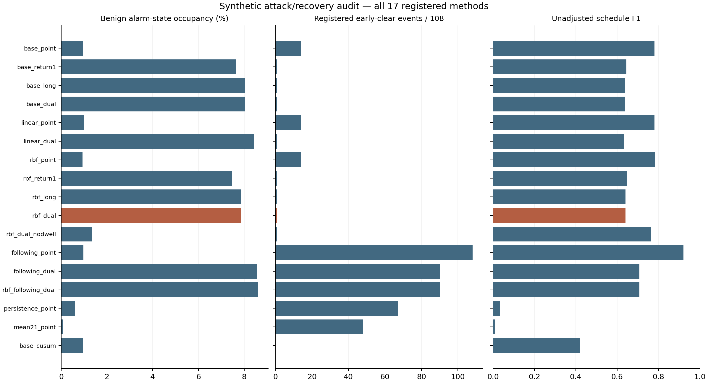
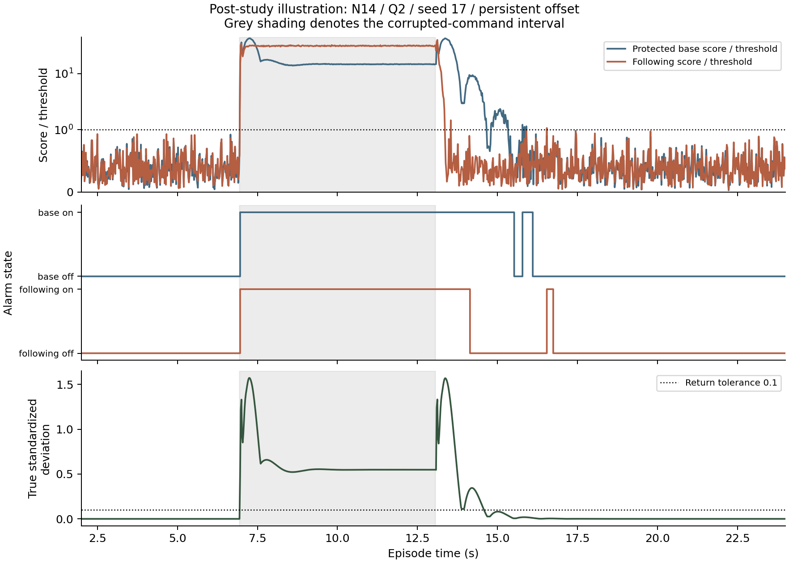

# Attack and recovery audit: results

## Material Passport

- Project: manufacturing. Operator: Codex, at the user’s explicit request. Date: 17 October 2026 (Asia/Karachi).
- Material: frozen, bounded synthetic experiment using saved models; no retraining or CASPER raw-data access.
- Verification: deterministic saved inference replay and separate metric arithmetic; not an independent real-robot replication.

## Decision

**The candidate did not meet the declared attack/recovery advantage criterion.** The nonlinear RBF correction reduced pooled benign occupancy by 2.01%, below the required 10%, and increased the registered pre-return gap count from two points to three. Q1 benign occupancy worsened. The primary conclusion remains unchanged despite favorable secondary comparisons.

There is a useful measured contrast: a protected command-driven reference retains evidence much better than a one-step-following reference. The ordinary base reference achieves that benefit too. It does not establish a distinct contribution from the nonlinear correction, short window or dwell counter.

## Complete main comparison

All rows have 207,900 eligible points, including 89,100 wholly benign points and 108 attack events. The schedule-positive population is 25,002 points. There is complete eligible coverage. F1 and AP use unadjusted corruption-schedule labels; post-corruption alarm retention may reduce precision. The separate recovery columns answer a different question.

| Method | F1 | AP | Benign alarm points | Overlap / fresh hits | Early-clear events | Pre-return gap points | Timely clears / detected-returned |
|---|---:|---:|---:|---:|---:|---:|---:|
| base_point | 0.7809 | 0.7276 | 853 | 108 / 108 | 14 | 38 | 108 / 108 |
| base_return1 | 0.6452 | 0.7276 | 6,811 | 108 / 101 | 1 | 2 | 108 / 108 |
| base_long | 0.6381 | 0.7276 | 7,156 | 108 / 101 | 1 | 2 | 108 / 108 |
| base_dual | 0.6381 | 0.7276 | 7,156 | 108 / 101 | 1 | 2 | 108 / 108 |
| linear_point | 0.7799 | 0.7276 | 895 | 108 / 108 | 14 | 38 | 108 / 108 |
| linear_dual | 0.6336 | 0.7276 | 7,498 | 108 / 101 | 1 | 2 | 108 / 108 |
| rbf_point | 0.7816 | 0.7276 | 835 | 108 / 108 | 14 | 39 | 108 / 108 |
| rbf_return1 | 0.6482 | 0.7276 | 6,652 | 108 / 105 | 1 | 3 | 108 / 108 |
| rbf_long | 0.6407 | 0.7276 | 7,012 | 108 / 105 | 1 | 3 | 108 / 108 |
| rbf_dual | 0.6407 | 0.7276 | 7,012 | 108 / 105 | 1 | 3 | 108 / 108 |
| rbf_dual_nodwell | 0.7644 | 0.7276 | 1,195 | 108 / 108 | 1 | 1 | 108 / 108 |
| following_point | 0.9202 | 0.9501 | 867 | 108 / 108 | 108 | 6,692 | 108 / 108 |
| following_dual | 0.7070 | 0.9501 | 7,635 | 108 / 105 | 90 | 2,970 | 108 / 108 |
| rbf_following_dual | 0.7069 | 0.9501 | 7,678 | 108 / 105 | 90 | 2,979 | 108 / 108 |
| persistence_point | 0.0333 | 0.1016 | 527 | 67 / 67 | 67 | 15,742 | 67 / 67 |
| mean21_point | 0.0082 | 0.0867 | 84 | 48 / 48 | 48 | 11,545 | 48 / 48 |
| base_cusum | 0.4198 | 0.1967 | 857 | 108 / 108 | 0 | 0 | 0 / 108 |

Continuous scores are shared across the return-rule variants, so their AP values are identical by construction. AP does not score the retained alarm state. Misses are visible in the hit counts: persistence misses 41 events and mean21 misses 60. Their clearance denominator excludes those misses and must not be described as overall success.

## What each component contributed

| Contrast | Measured finding | Interpretation |
|---|---|---|
| RBF dual vs base dual | Same 108 overlap hits and one early-clear event; benign points 7,156→7,012; gap points 2→3 | The nonlinear correction provides no worthwhile overall advantage under the frozen criterion. |
| RBF dual vs RBF long | Exactly 0 different alarm entries across all 189 episodes | The short-window component contributes nothing to these outputs. This is empirical equality, not a theorem for every input. |
| RBF dual vs no-dwell | Benign points 7,012→1,195; same 108 hits and one registered early-clear event; timely clear 108/108 for both | Dwell is costly in these conditions. The two early-clear events occur on different episodes; matching counts do not imply identical behavior. |
| Base dual vs following dual | Early-clear events 1→90; gaps 2→2,970; following F1 0.7070 vs base 0.6381 | Following is stronger on schedule F1 but loses sustained evidence more often. Neither metric alone establishes overall superiority. |
| Following point vs RBF dual | F1 0.9202 vs 0.6407; early-clear events 108 vs 1 | High schedule detection performance can coexist with poor retained evidence under this recovery objective. |
| Base CUSUM | 108 hits, no pre-return gaps, 0/108 timely clearances | Accumulated evidence retains alarms but does not clear within the declared horizon. |

## Plant strata for the primary comparison

| Plant | Base / RBF benign points | Base / RBF pre-return gaps | Base / RBF fresh hits |
|---|---:|---:|---:|
| Q1 | 2397 / 2522 | 0 / 0 | 36 / 36 |
| Q2 | 2646 / 2532 | 2 / 3 | 29 / 33 |
| Q3 | 2113 / 1958 | 0 / 0 | 36 / 36 |

Complete plant summaries, all task/condition strata and every event—including misses and conditional delays—are in `summary.csv`, `strata.csv` and `events.csv`. No favorable stratum replaces the primary all-plant requirement.

## Meaning of “early clear”

The registered metric counts an alarm falling after the first overlap and before a stable post-corruption return. It includes a preexisting benign alarm that overlaps onset and then falls before a fresh detection. It is stricter than asking whether the physical deviation exceeds tolerance at the falling edge.

For the RBF candidate, the one registered event is N14/Q2/seed42/slow. Its alarm falls at index 349, only two samples after onset 347, with true standardized deviation 0.0164868—below 0.1. A new alarm starts at index 352. This is an early continuity break under the registered criterion; it is not evidence that the robot was outside tolerance at that instant. The base control has two gap points in the same episode; the candidate has three. Do not inflate that one-point difference into a major safety finding.

A post-study diagnostic evaluates every early falling edge against truth at that instant. It is labelled exploratory and does not replace the primary result:

| Method | Events with an early fall while true deviation exceeds 0.1 |
|---|---:|
| base_point | 0 |
| base_return1 | 0 |
| base_long | 0 |
| base_dual | 0 |
| linear_point | 0 |
| linear_dual | 0 |
| rbf_point | 0 |
| rbf_return1 | 0 |
| rbf_long | 0 |
| rbf_dual | 0 |
| rbf_dual_nodwell | 0 |
| following_point | 108 |
| following_dual | 82 |
| rbf_following_dual | 83 |
| persistence_point | 67 |
| mean21_point | 48 |
| base_cusum | 0 |

The evaluator can compute the counterfactual state because this is simulation. The monitor cannot. No physical safety guarantee or real-world attack detection result follows. A second plot illustrates the registered protected/following contrast for the first task, Q2, seed 17, persistent offset; this is a post-study illustration, not an additional independent experiment.

## Calibration, provenance and cost

Saved base/linear/RBF fits and thresholds were unchanged. New controls used the same five old normal calibration episodes per plant, rank 5,445 of 5,500, and strict exceedance. The CUSUM reference statistic used training only. No model, gate or threshold was chosen using these attacks. Equal point quantiles do not equalize stateful alarm occupancy; calibration burdens are preserved in calibration.json.

The single run completed in 27.515 s wall and 26.656 s worker CPU. Sampled peak RSS was 90.17 MiB; worker getrusage peak was 99.53 MiB. Monitored output was 83.44 MiB. All stayed within 120 s / 90 s / 1 GiB / 128 MiB. Sampling is not an instantaneous memory ceiling. Costs cover the shared 17-method pipeline, not independently measured per-method deployment latency.

25 synthetic tests passed before freezing 26 source/test bindings and 303 prior evidence identities. A fresh-process verifier passed 30,448 checks in 6.457 s, replaying all references/scores/alarms and independently computing event, contingency, AP and primary-outcome arithmetic. No run failed or retried. Full scores were sealed before joint truth evaluation.

## Scientific interpretation audit

| Check | Disposition |
|---|---|
| Simpson/group reversal | Primary plant strata and full task/condition tables retained; Q1 worsening remains visible. |
| Ecological inference | No generalization across real robots or manufacturers. |
| Selection bias | Fixed synthetic tasks/conditions; not a representative deployment sample. |
| Collider bias | No result-conditioned filtering or method exclusion. |
| Base rates | 25,002/207,900 schedule-positive points; precision is specific to this constructed mixture. |
| Regression to mean | Paired controls and unchanged fits; v0.13 failure remains acknowledged. |
| Survivorship | All 189 episodes / 3,213 outcomes retained; misses and no-clear outcomes visible. |
| Look-elsewhere | Primary failed; secondary contrasts do not replace it. |
| Forking paths | Frozen settings; post-study early-fall clarification explicitly labelled. |
| Causality | Controlled software ablations, not causal claims about industrial deployments. |
| Reverse causality | Training/calibration before generation; no labels/truth/schedule in detector input settings. |

All 11 categories were considered using the research skill guidance. No significance tests or confidence intervals are invented. Three paired noise seeds reuse simulator/task/plant structure. This is a same-assistant audit, not external peer review.

## Contribution decision

Retire the RBF-plus-dual-window assembly as a claimed improvement on this evidence. Keep its code and all negative outcomes as development records. The protected-reference contrast is scientifically useful, but is also achieved by the simpler base model and does not demonstrate a new algorithm. See [novelty audit](NOVELTY_AUDIT.md). CASPER/Edge are not beaten by these results: they use different information, and full compatible paper-level reproduction remains unresolved.

A new model proposal should begin with a specific failure in a compatible published baseline and independent evidence. FactoryNet is a new public-data lead with explicit setpoint/feedback structure, but its latest manuscript/release, permissions, fault semantics and trusted-input correspondence still need admission. It has not been downloaded or used. The user’s original-method publication objective remains active; this audit is not silently substituted as the intended journal contribution.

