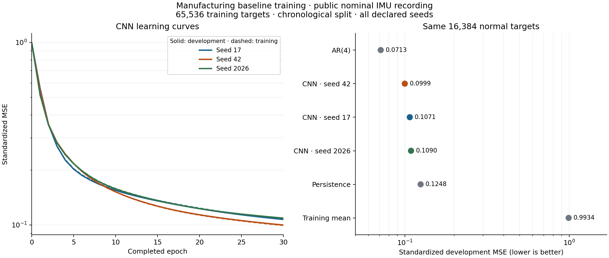

# Trained compact CNN baseline and normal-development controls

## Material Passport

- Project: manufacturing; owner Haiqa Mushtaq; operator Codex under the user's implementation/run instruction.
- Study: `manufacturing-baseline-training-v0.3`, 17 October 2026.
- Status: **completed** — three fitted CNN artifacts, three ordinary controls, complete learning curves and verified saved predictions.
- Scope: independently implemented Edge-2025 compact architectural family under the [frozen normal-only protocol](PLAN.md); all measured values derive from [RESULTS.json](RESULTS.json).
- Verification: fresh-process inference and saved-artifact arithmetic passed **410/410** checks. This is a software/result readback, not independent scientific peer review.

## What was executed

One accepted supervised attempt fitted all three seeds, **17, 42 and 2026**, on **65,536** eligible normal targets and scored **16,384** subsequent development targets. No windows were excluded: both populations had 100% coverage under the declared timestamp-boundary rule. Training rows `[219,65800)` and development rows `[65800,82229)` were split before 45-step windows. Only the permitted nominal prefix was parsed; the full nominal file was hashed for identity.

The existing isolated Python 3.12.15 / TensorFlow 2.16.2 environment was reused unchanged. Each CNN has 1,369 parameters; batch 1024, Adamax 0.001, no shuffle, maximum 30 epochs, patience five, minimum improvement `1e-6`. Every seed selected epoch 30 by the frozen rule. All seed results are retained. The artifacts contain inference weights and explicit architecture/scaler metadata; they intentionally omit optimizer state.

## Measured outcomes

All values below describe **normal one-step prediction**, with lower MSE indicating more accurate forecasts on this block. Standardized-channel MSE is the predeclared checkpoint-selection quantity. Native-channel MSE applies the recorded per-channel scales back to the residuals; its channels have different physical units and it is a secondary score-semantic diagnostic.

| Method | Standardized MSE | Inverse-scaled native MSE | Selected epoch |
|---|---:|---:|---:|
| Training mean | 0.993411 | 327.260275 | — |
| Persistence | 0.124758 | 6.096400 | — |
| AR(4) | 0.071310 | 1.144786 | — |
| CNN · seed 17 | 0.107139 | 21.266880 | 30 |
| CNN · seed 42 | 0.099925 | 15.732082 | 30 |
| CNN · seed 2026 | 0.109027 | 18.360218 | 30 |

Across CNN seeds, standardized MSE is **0.105364 ± 0.004803** (arithmetic mean ± sample standard deviation). This is **15.55% lower** than persistence on the same targets. AR(4) is the strongest predictor under both reported losses. It remains a required control in the next study. The three seeds describe computational variation on this recording, not three independent robot experiments.

[Editable vector figure](../../output/baseline_training_v0.3/learning_curves.svg). Figures are generated directly from saved epoch logs and model records; no observations are synthesized or removed for presentation.

All CNN curves continued improving at the declared epoch cap. These are valid selected artifacts from the bounded study; a convergence plateau has not been demonstrated. The standardized ranking and inverse-scaled ranking differ: every CNN beats persistence on standardized MSE, while persistence has lower native MSE. This makes the scoring convention an explicit experimental choice. It does not by itself demonstrate an attack-detection weakness or determine future alarm performance.

## Resources and failures

The full attempt took **57.851 s supervised wall time**, **56.526 s worker CPU**, **520.16 MiB sampled peak RSS**, and **7,450,612 bytes** of outputs before the final supervisor receipt. All four caps passed: 600 s wall, 300 s CPU, 1 GiB monitored RSS, 50 MiB outputs. Runtime platform: Apple M5 Pro, 18 logical CPUs, 24 GiB RAM, macOS arm64; workers use single-thread settings. RSS monitoring is sampled, not an instantaneous memory ceiling.

| Method | Fit/development-selection wall seconds | Prediction-only wall seconds for all development targets |
|---|---:|---:|
| Training mean | 0.000000 | 0.000016 |
| Persistence | 0.000000 | 0.000091 |
| AR(4) | 0.007821 | 0.002786 |
| CNN · seed 17 | 17.273026 | 0.045623 |
| CNN · seed 42 | 18.391635 | 0.046926 |
| CNN · seed 2026 | 18.038710 | 0.049206 |

CNN fit cost includes initialization evaluation and repeated post-epoch training/development evaluation. Control fit cost excludes the shared scaler/loading step. Prediction timings exclude score calculation and file I/O. They are single laptop measurements, not end-to-end alarm latency or edge-device timing.

**Training failures/retries: zero. Synthetic test failures: zero.** The 25-test suite and all three seed fits completed on their first named attempts. Dependency deprecation/cache warnings were preserved in setup/test logs. Earlier v0.2 failures remain unchanged and are not erased from project history.

## Verification and usable artifacts

The fresh-process verifier loaded each selected checkpoint and reproduced all 16,384 saved predictions exactly. Separate NumPy calculations checked endpoint alignment, point/channel/aggregate error, every epoch-selection decision, stopping conditions, controls and resource limits. It also checked all 52 old source/configuration identities, 133 frozen input bindings, three old freeze/completion records, the old PDF and all previously bound v0.2 artifacts.

- [Pre-execution source/config/test freeze](FREEZE.json): 13 source/configuration identities after 25 passing synthetic tests.
- [Actual training artifacts](../../local/baseline_training_v0.3/runs/training_001/): all CNN weights, scaler/development arrays, AR coefficients, score/prediction arrays, epoch CSV, provenance and supervisor receipt.
- [Fresh-process verification](../../local/baseline_training_v0.3/verification/verify_001/verification.json).
- [Complete safe result summary](RESULTS.json) and [executable usage](README.md).

Raw data, fitted artifacts and environments remain local and ignored by Git. The new plotting environment is separate; the training environment and previous experiment bytes remain unchanged. No attack metric, threshold calibration or final-test exposure occurred.

## Next experimental use

Use these saved predictors and AR/persistence controls as the reference for a separately specified **exploratory limitation experiment** on brief versus persistent motion deviations. Any additional training budget must be declared before that experiment; its outcomes must not choose checkpoints. The trained pipeline, reproducible artifacts and normal-development measurements are now available. The broader novelty question is addressed by the next mechanism experiment, rather than by treating notebook corrections as a new algorithm.
