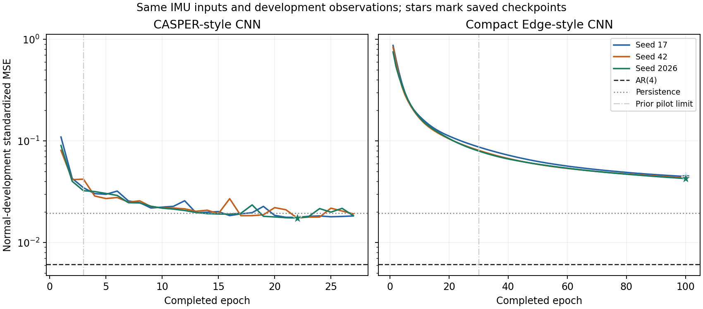

# Common-input normal convergence study: results

## Material Passport

Manufacturing / Haiqa Mushtaq; operator Codex under the user's explicit approval of the prepared local run. 17 October 2026. Academic-research-suite run/validate workflow applied inline. One completed scientific execution, `pilot_001`, of the unchanged [frozen protocol](PLAN.md). No paid compute, package changes, attack evaluation or public release.

## Outcome

All nine declared outcomes completed. Of the six CNN fits, **3 stopped by normal-development patience, 0 by the per-fit CPU admission cap, and 3 by the epoch cap**. The following fits remain limited by their declared epoch/CPU cap: edge_cnn_seed17, edge_cnn_seed42, edge_cnn_seed2026. Do not call the entire roster adequately converged or silently drop these fits. Patience-ended fits satisfy this local stopping rule; it does not prove a global optimum.

CASPER-style MSE across all three seeds: 0.017451–0.017703. Compact Edge-style MSE across all three seeds: 0.042700–0.044730. The lowest standardized mean prediction error in this normal prefix is `ar4` at 0.006074. This is a normal-development prediction comparison. No detection threshold, attack F1, recovery performance or new-method superiority was measured.

## All declared outcomes

MSE is the average squared standardized error for the next causally filtered observation over the same 2,048 development targets and nine IMU channels. The prior comparison used identical data and model definitions, with shorter training limits. Reduction is `100*(1-current/prior)`; it is descriptive and uses reused development observations. These errors concern the filtered series, not prediction accuracy for unsmoothed raw motion.

| Method / seed | Prior MSE | Current MSE | MSE reduction | Completed / saved epoch | Stop |
|---|---:|---:|---:|---:|---|
| mean | 1.073987 | 1.073987 | 0.00% | — | Closed form |
| persistence | 0.019432 | 0.019432 | 0.00% | — | Closed form |
| ar4 | 0.006074 | 0.006074 | 0.00% | — | Closed form |
| casper_cnn_seed17 | 0.034652 | 0.017703 | 48.91% | 27 / 22 | Patience |
| casper_cnn_seed42 | 0.041666 | 0.017451 | 58.12% | 27 / 22 | Patience |
| casper_cnn_seed2026 | 0.032397 | 0.017458 | 46.11% | 27 / 22 | Patience |
| edge_cnn_seed17 | 0.087276 | 0.044730 | 48.75% | 100 / 100 | Epoch cap |
| edge_cnn_seed42 | 0.080812 | 0.043451 | 46.23% | 100 / 100 | Epoch cap |
| edge_cnn_seed2026 | 0.079634 | 0.042700 | 46.38% | 100 / 100 | Epoch cap |

[Machine-readable all-outcome table](all_outcomes.csv) includes native-unit errors and recorded computation costs. [Per-channel errors](per_channel_errors.csv) preserve all 81 model/channel rows. Native-unit errors weight heterogeneous units differently and are not physical-distance estimates. No winning seed is selected for a final experiment.



Curves show every completed epoch. Stars identify saved checkpoints; gray vertical lines show the preceding pilot's completed-epoch limits. AR(4) and persistence share the exact evaluation targets. The figure is generated from the saved histories, not reconstructed from a narrative or published headline score.

## Data and computation

Same authorized CASPER1&2 provider-v2 nominal `IMU_10Hz.csv`, SHA256 `1221df9be80c229969f3f21f820837e68ad28f4ccb3949bf4013f00d6d69d62c`. At most 12,007 numeric records parsed, all in previously exposed normal development. Raw train `[219,9185)` and development `[9185,12007)` are split before independent causal trailing-20 medians; training-only scaling and gap rejection are unchanged. There are 8,192 training targets, 2,048 development targets and 1,294 complete rolling-755 residual sums for every model. Timestamp units remain unresolved; this report infers no physical-time detection delay from the filename. The nominal provider-v2 file is not established as the exact original CASPER publication-run release.

All fits restarted because the previous pilot did not retain optimizer state. Same architectures, seeds 17/42/2026, Adamax .001, chronological batch64, no shuffling, patience5 and minimum improvement1e-6. This version allowed at most100epochs and240CPU seconds per fit. The whole-run limits were 1,200s wall,900s CPU,1GiB monitored RSS and50MiB outputs. The user explicitly approved those limits before execution; the launcher's approval check had previously been tested to block execution while pending.

**Measured execution:** 764.794s supervised wall time (12.75minutes); 753.252s worker CPU; 553.05MiB sampled RSS; 553.05MiB worker lifetime peak; 2.68MiB supervised outputs. All recorded limits passed. RSS sampling is not an instantaneous ceiling. Per-model costs include fitting and normal-development evaluation; these are not standardized latency benchmarks. Wall time reported by the supervisor includes startup excluded by the worker's internal timer.

The hardware inventory recorded macOS/arm64 and18logical CPUs, with the experiment constrained to one TensorFlow/BLAS thread. A separate `sysctl` inventory probe was denied in the sandbox; memory capacity was not remeasured. Worker provenance records the actual isolated research interpreter and dependencies; the inventory helper's interpreter is separately labelled.

## Verification and limitations

Seventeen synthetic tests passed before the freeze; source hashes and the test receipt were checked again before launch. **3,754 fresh-process checks passed** after completion: all nine predictions/scores, six CNN weight reloads, no inference mutation, independent AR calculation and rolling arithmetic, every saved checkpoint, exact training/development population parity with v0.10, and identical shared training trajectories where the runs overlap. Prior immutable scientific packages and manuscripts remain unchanged. The verifier used derived saved observations and no new raw/attack access; it did not retrain the CNNs.

This is an independent architectural implementation under a modified normal-only protocol. It is not the original evaluated checkpoint, full publication experiment, independent robot acquisition or attack benchmark. Three seeds characterize optimization variation on this one recording. Lower normal MSE does not imply better detection: an accurate predictor can also follow an abnormal process. The data, transformations and stopping choices must remain frozen before any separately specified calibration or evaluation.

## Interpretation audit

Eleven statistical pitfalls were considered for this descriptive study; no significance tests or inferential confidence intervals were calculated.

| Check | Disposition |
|---|---|
| Simpson's paradox / aggregation | All seeds and per-channel errors retained; standardized and native weighting distinguished. No cross-plant aggregate. |
| Ecological inference | Findings restricted to this prefix; rows and seeds are not independent robots or tasks. |
| Selection bias | Reused normal-development prefix explicitly identified; it does not estimate deployment prevalence. |
| Collider conditioning | No regression-adjusted causal effect or subgroup-selected performance claim. |
| Base-rate neglect | No attack precision, recall or security success inferred from normal MSE. |
| Regression to the mean | Same deterministic shared trajectories checked; all seeds retained. Repeated development selection is still optimistic for fresh-data performance. |
| Survivorship | Every registered method/seed and terminal outcome is reported. No favorable-seed filtering. |
| Multiple searching | Full fixed roster and both error conventions retained; no significance claim or post-hoc winner selection. |
| Forking paths | Explicit frozen change in training allowance; prior short pilot and all later stopping reasons remain visible. |
| Causal overreach | Additional epochs describe computational learning on fixed data, not causal physical-security improvement. |
| Reverse causality / leakage | Predictors use strictly earlier filtered observations; split and target alignment verified. Attack labels are absent. |

## Consequence for the original research goal

This run improves the evidence about comparator training adequacy. The next scientific work remains the [common-information and mechanism decision](../casper_comparison_v0.10/DECISION.md): distinguish physical-return evidence from noise/model error, establish a concrete difference from standard statistical/observer controls, and require a fresh, frozen compatible evaluation. This run authorizes no automatic attack experiment or further budget extension. Preserve the current AFTER manuscript and prior negative findings.

Executed from the workspace root:

```sh
manufacturing/.venv-reproduction-v02/bin/python manufacturing/research_cycles/casper_convergence_v0.11/run.py
manufacturing/.venv-reproduction-v02/bin/python manufacturing/research_cycles/casper_convergence_v0.11/verify.py
manufacturing/.venv-plots-v03/bin/python manufacturing/research_cycles/casper_convergence_v0.11/present.py
manufacturing/.venv-reproduction-v02/bin/python manufacturing/research_cycles/casper_convergence_v0.11/report.py
```

The consumed launcher cannot be rerun in the same attempt directory. Exact commands, approvals, logs, revisions, dependencies and resource receipts remain in local storage and the final package manifest.
