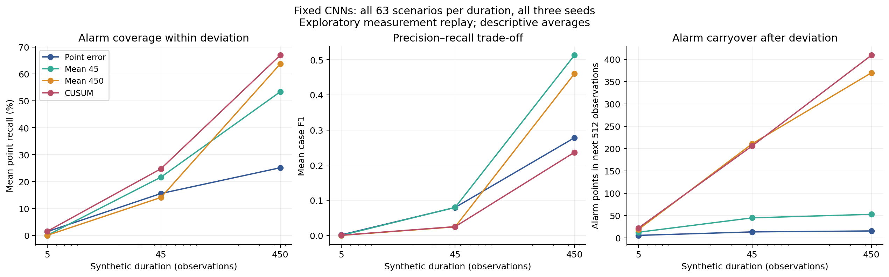
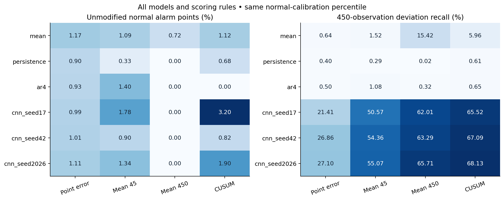
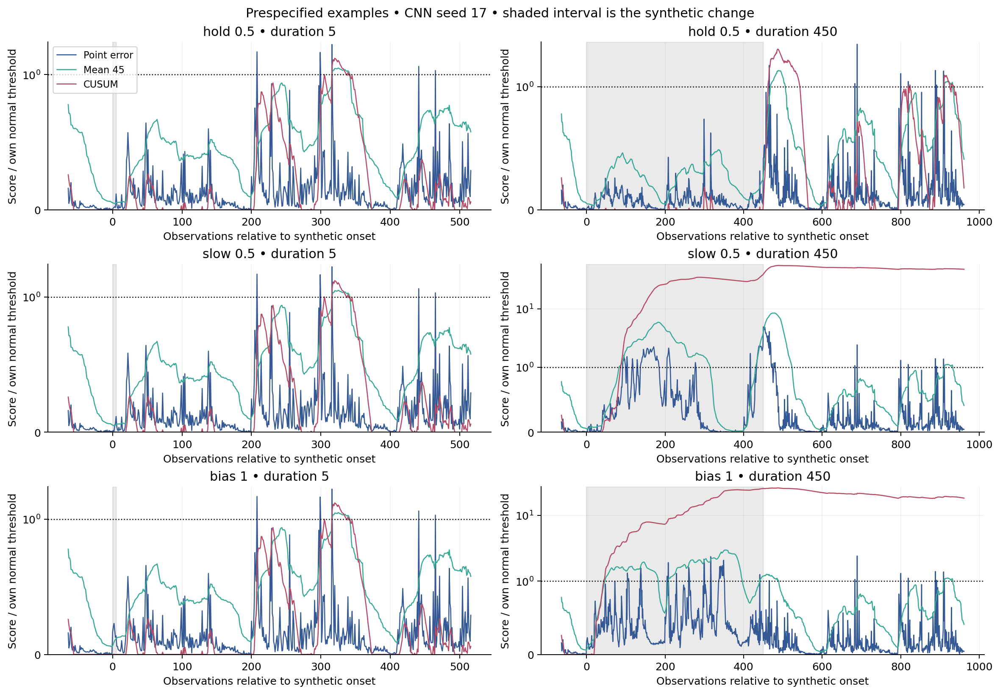

# Brief and persistent deviations: measured limitation and improvement test

## Material Passport

**Completed 17 October 2026.** Manufacturing; owner Haiqa Mushtaq; operator Codex. Exploratory synthetic measurement replay using fixed v0.3 models. No fitting or new raw/final observations. All 26,374/26,374 fresh-process verification checks passed.

## Main finding

The experiment supports a **conditional history-assimilation effect**, not a universal collapse of CNN prediction error. Altered histories usually reduce error relative to the clean-history counterfactual for holds and slow playback. However, late CNN error does not consistently fall below early error, and sensor offsets often amplify it. Thus “the baseline learns every persistent deviation as normal” is contradicted by this experiment. Model weights never changed.

A causal CUSUM-style accumulator increases long-deviation alarm coverage, but produces substantial carryover and lower overall F1 than a 45-observation rolling mean. The simpler rolling mean is the better measured compromise here. This is an established scoring technique, not an original digital-twin contribution.

## Execution and comparison

189 scenarios = 3 families × 3 severities × 3 durations × 7 fixed onsets. Six fixed predictors and four scoring rules produce 4,536 case outcomes. All models use the same 4,096 normal threshold-calibration targets, rank 4,056 and strict exceedance; 8,192 later unmodified normal targets measure alarm burden. These are roles inside previously exposed normal development, not a new holdout. Scores run continuously without event-boundary resets. All predictions and calibration were sealed before outcome calculation.

Holds, slow playback and gyroX offsets are explicitly synthetic edits to recordings. Slow playback does not rescale robot dynamics or accelerations. Neither these edits nor their labels establish physical motion, attacks, cyber intent or live security. Delays and rates use observations because time units remain unresolved.

## CNN results across all declared seeds

Each row averages the same 63 scenarios repeated for three fixed CNN seeds (189 dependent seed-case outcomes). F1 is a mean of case-level unadjusted F1 across the full 8,192-target evaluation interval; it is not computed from pooled counts. Event hits mean any alarm overlap; fresh starts and missed outcomes remain separate.

| Duration | Score | Point recall | Mean F1 | Event hits / 189 | Fresh starts / 189 | Post-event alarm points / 512 | Uncleared at 512 |
|---:|---|---:|---:|---:|---:|---:|---:|
| 5 | Point error | 1.38% | 0.0015 | 9 | 9 | 5.67 | 0 |
| 5 | Mean 45 | 0.00% | 0.0000 | 0 | 0 | 12.66 | 0 |
| 5 | Mean 450 | 0.00% | 0.0000 | 0 | 0 | 18.72 | 0 |
| 5 | CUSUM | 1.48% | 0.0004 | 4 | 4 | 22.01 | 0 |
| 45 | Point error | 15.56% | 0.0795 | 80 | 80 | 13.44 | 0 |
| 45 | Mean 45 | 21.63% | 0.0796 | 80 | 80 | 44.87 | 0 |
| 45 | Mean 450 | 14.09% | 0.0243 | 64 | 64 | 210.59 | 0 |
| 45 | CUSUM | 24.75% | 0.0249 | 84 | 84 | 205.78 | 46 |
| 450 | Point error | 25.12% | 0.2778 | 159 | 159 | 15.58 | 0 |
| 450 | Mean 45 | 53.33% | 0.5127 | 154 | 154 | 52.81 | 0 |
| 450 | Mean 450 | 63.67% | 0.4601 | 154 | 154 | 369.47 | 0 |
| 450 | CUSUM | 66.91% | 0.2364 | 155 | 155 | 408.71 | 128 |

For 450-observation deviations, point error detects some part of 159/189 seed-case events, versus 155/189 for CUSUM. Higher point recall therefore means more alarm coverage inside events, not more events detected. The 45-point mean raises descriptive mean F1 from 0.2778 to 0.5127, while missing more events and carrying alarms further after release. CUSUM remains active for all 512 post-event observations in 128/189 long seed-case outcomes. For five-observation deviations, both rolling means miss all 189 events; CUSUM has only four fresh event starts. A detection-delay median conditional on hits must not conceal these misses; all null delays are retained in local case outcomes.

## Normal alarms and strong controls

| Model | Point alarm % | Mean45 alarm % | Mean450 alarm % | CUSUM alarm % |
|---|---:|---:|---:|---:|
| mean | 1.172 | 1.086 | 0.720 | 1.123 |
| persistence | 0.903 | 0.330 | 0.000 | 0.684 |
| ar4 | 0.928 | 1.404 | 0.000 | 0.000 |
| cnn_seed17 | 0.989 | 1.782 | 0.000 | 3.198 |
| cnn_seed42 | 1.013 | 0.903 | 0.000 | 0.818 |
| cnn_seed2026 | 1.111 | 1.343 | 0.000 | 1.904 |

A common calibration percentile does not yield identical later false-alarm rates. The three CNN CUSUM rates range from 0.818% to 3.198%; point-scoring rates range from 0.989% to 1.111%. AR remains the strongest normal predictor from v0.3, but low prediction error alone does not imply useful deviation detection. Persistence has analytically zero error after the first full-hold sample. Mean, AR and persistence remain visible in the complete tables and figure.

## What the history diagnostic establishes

The oracle uses the original, unmodified prediction history but the same altered target; it is excluded from the main comparison. The ratio below is median late actual MSE divided by late oracle MSE over all 21 long cases per family, separately for each fixed model. Values below one mean changed histories reduce discrepancy; above one mean they increase it.

| Model | Holds | Slow playback | Sensor offsets |
|---|---:|---:|---:|
| mean | 1.000 | 1.000 | 1.000 |
| persistence | 0.061 | 0.011 | 0.499 |
| ar4 | 0.087 | 0.029 | 0.387 |
| cnn_seed17 | 0.716 | 0.346 | 1.629 |
| cnn_seed42 | 0.579 | 0.318 | 2.628 |
| cnn_seed2026 | 0.691 | 0.332 | 1.697 |

Across the CNN seeds, late error is lower than early error in only 18/63 hold, 25/63 slow-playback and 9/63 offset outcomes. The corresponding counts with late error below the oracle are 48/63, 54/63 and 2/63. These paired results distinguish history conditioning from a general temporal decline. The mean predictor has an exact ratio of one because it ignores history; the verifier checks that identity.

## Decision and next scientific step

1. Retain point error and the 45-point rolling mean as mandatory reference scorers. Keep the longer mean and accumulator as memory/carryover controls; do not present CUSUM as a successful general solution.
2. The candidate problem is now sharper: preserve evidence of a sustained execution change while clearing it when the process demonstrably returns, without suppressing brief events. Simply accumulating residuals does not solve all three objectives.
3. A context-aware recovery observer would need information beyond these residuals. Next specify a small dynamics-based simulation with permitted command context, plant/observer mismatch and legitimate changes; compare ordinary filters/reset rules using the same context. Freeze meaningful held-out task/plant conditions before generating their outcomes.
4. Any mechanism designed from these outcomes is exploratory. Establish its exact difference from close prior art and then test it on fresh evidence. No new novelty, publication readiness or universal CASPER-family failure is claimed.

## Reproducibility and limitations

The scoring campaign took **6.198s wall**, **4.799s CPU**, **453.77MiB sampled peak RSS** and **20,015,464 bytes** before the supervisor receipt. All caps passed; one scoring attempt and one successful verification attempt. All six models, all seeds, cases and misses remain visible.

22 synthetic tests passed before freezing. The first test attempt failed one float32 offset assertion (3.8e-6 rounding); the fixture tolerance was corrected to one float32 spacing, with the failed log retained. No scientific run failed or required a parameter change. The verifier separately recomputed energy, calibration, convolution-based smoothing, recursive CUSUM, point/event/post-event metrics, full-versus-optimized predictions and all frozen identities. This is software verification, not independent scientific replication.

The old controller-data holdout remains exposed; this work uses a separate IMU nominal prefix already used for development. All CNNs had reached a fixed training cap, so capacity/training effects remain unresolved. Synthetic cases, seeds and windows are not independent robots. No confidence interval or significance claim is inferred. Thresholds were calibrated on correlated normal scores; empirical ranks do not supply sequential false-alarm guarantees. First-clear timing does not guarantee sustained recovery; later alarms and post-event alarm counts are retained.

See [protocol](PLAN.md), [freeze](FREEZE.json), [machine-readable results](RESULTS.json), [all model/family/duration aggregates](aggregate_outcomes.csv), [execution and replay instructions](README.md), [local full outcomes](../../local/limitation_v0.4/runs/replay_001/case_outcomes.json) and [verification](../../local/limitation_v0.4/verification/verify_001/verification.json). CUSUM background: [NIST control-chart handbook](https://www.itl.nist.gov/div898/handbook/pmc/section3/pmc323.htm).
