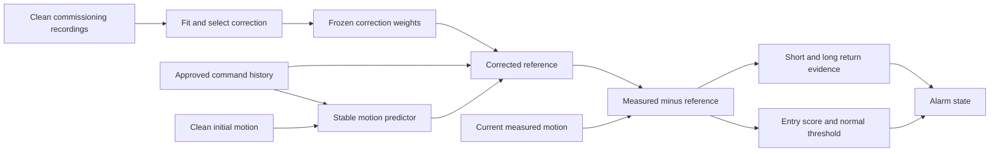

# Proposed model: a command-conditioned residual twin

**Status:** implemented research candidate, with a completed normal-only simulation pilot. This is a working description, not a finalized paper title. [Results](RESULTS.md), [implementation](model.py), [frozen protocol](PLAN.md) and [prior-art boundary](PRIOR_ART.md) accompany it.

## The idea in ordinary language

The model predicts how a robot should move when it follows approved commands. A small learned correction compensates for errors in that prediction. It learns the correction during clean commissioning and then freezes it. During monitoring, measured motion is compared with the predicted motion, but it cannot teach the model to accept a suspicious movement as normal.

An alarm starts when the difference becomes unusually large. To clear it, the model requires a short and a longer stretch of measurements to agree with its reference. This is a candidate decision rule; agreement with a model does not by itself prove physical recovery.

There is no arrow from current measured motion to the reference after initialization. Approved commands still change the reference, so a legitimate task change can be represented without learning from possibly corrupted measurements. The present system does not perform online parameter adaptation.

## Model definition

Let \(y_t\in\mathbb R^4\) contain two joint positions and two joint velocities, and let \(u_t\in\mathbb R^4\) contain the approved position/velocity commands. The model maintains the last \(p\) predicted states and commands, the trailing residual buffers, an alarm bit and a return-evidence counter. Positions and velocities retain their physical coordinates; this is an empirical motion reference, not an identified rigid-body simulator.

**Base recurrence.** Clean training observations supply means \(\mu\), positive channel scales \(s\), and an autoregressive model with exogenous commands (ARX). For standardized predicted state \(b_t\),

\[
b_t=a+\sum_{k=1}^{p} A_k b_{t-k}+\sum_{k=1}^{p}B_k u_{t-k},
\qquad r_t^0=\mu+s\odot b_t.
\]

The first 100 measured states initialize the recurrence. Later predictions use the model's own history. The inherited fitted companion matrix has spectral radius below one. Selected orders are 8,16,32 for the three simulated plants. These plant-specific models are not zero-shot transfer across robots.

**Learned correction.** Define the 20-dimensional feature vector

\[
x_t=[r_t^0,u_{t-1},u_{t-4},u_{t-16},u_{t-32}],\qquad
z_t=(x_t-\mu_x)/s_x.
\]

Training-only means and standard deviations define \(\mu_x,s_x\); constant feature scales become one. Deterministic farthest-point selection chooses centers \(c_i\) from training features. A radial-basis-function (RBF) layer gives

\[
\phi_i(z_t)=\exp[-\|z_t-c_i\|_2^2/(2h^2)],\qquad
r_t=r_t^0+s\odot W^T[\phi_1(z_t),\ldots,\phi_K(z_t),1]^T.
\]

For target \(e_t^{\rm train}=(y_t-r_t^0)/s\), fit the four-output head by

\[
\underset{W}{\operatorname{argmin}}\;N^{-1}\|\Phi W-E\|_F^2+
\lambda\|W_{1:K,:}\|_F^2.
\]

The intercept is not penalized. This is a shallow nonlinear regression model with a closed-form ridge solution, not a transformer. The nonlinear output is added to the reference but never fed back into the ARX recurrence. Because each RBF activation lies in [0,1], each standardized correction coordinate is bounded by the sum of its absolute output weights. This bounds the correction for fixed weights; it does not bound physical prediction error.

**Detection and return.** For residual \(e_t=(y_t-r_t)/s\), the entry score is \(a_t=\max_j|e_{t,j}|\). Enter alarm only when \(a_t>\tau\). The threshold is normal-calibrated at the declared order statistic; no attack labels are used. Define

\[
g_t=\mathbf1\!\left\{
\max_j\left|\frac1{5}\sum_{k=0}^{4}e_{t-k,j}\right|\le0.1
\;\land\;
\max_j\left|\frac1{41}\sum_{k=0}^{40}e_{t-k,j}\right|\le0.1
\right\}.
\]

Clear an active alarm after ten consecutive eligible points with \(g_t=1\) and no entry exceedance. A new entry exceedance has priority and resets the counter. These signed means can cancel oscillating deviations; the short window only reduces some cancellation, and does not eliminate that failure mode. The gate is not a physical-return certificate. At 50 Hz the windows span 0.10s and 0.82s; the ten-point dwell is 0.20s of samples. Endpoint delay depends on event timing.

## Information and threat assumptions

- Clean commissioning and the initialization prefix are trusted. An attack during initialization is outside this version's guarantee.
- The monitor's approved-command channel is protected and available. Compromise of both commands and observations can defeat the reference's meaning.
- Subsequent measured-state corruption can affect scores and alarm decisions but cannot change the frozen reference, given unchanged commands and initialization. Synthetic tests and saved-artifact replay verify this limited information-flow property.
- The simulator's true state, executed malicious commands and counterfactual state are evaluator-only. This pilot exposes no attack conditions to the model.
- The gate function abstains after missing command context. The integrated normal-pilot observation interface rejects incomplete-context episodes entirely; missing-context deployment behavior is not admitted by this pilot.

## Why compare these components

The uncorrected ARX measures whether a correction is useful. A linear correction with exactly the same features measures whether nonlinearity is useful. Point-only, long-window and dual-window return rules measure the cost of averaging and retaining a short-window check. Both long-window and dual-window rules already include temporal persistence; calling only one “temporal” would be misleading.

Residual learning, system identification and alarm hysteresis are established. The candidate research hypothesis concerns their behavior under a specified protected-command information boundary. It becomes a contribution only if it has a worthwhile advantage over close prior methods and strong controls under that same information access. The [pilot](RESULTS.md) does not meet its all-plant improvement criterion, so the current architecture is a tested candidate rather than the final paper's proven contribution.

## Optimization and selected parameters

Each plant used three training episodes, nine development episodes and five calibration episodes. They are reused synthetic commissioning material, not new independent recordings. Parameters were selected only on the nine development episodes. The finite search contains eight RBF settings (32/64 centers, width multiplier 0.5/1, ridge 0.001/0.01) and two linear settings. Selection minimizes worst-episode 99th-percentile residual, then mean RMSE, parameter count and identifier. No gradient training or post-result search was performed.

The selected parameters and all 30 candidates are reported in [RESULTS.md](RESULTS.md). They are best within this declared grid and development criterion; they are not globally optimal. The 20-feature RBF model has a four-output head and fixed training-derived centers. A larger/deeper model needs a separate scientific reason and comparison, rather than being added merely to use fashionable terminology.

## Five validation questions for the contribution paper

| Experiment | What would be tested | Current status |
|---|---|---|
| 1. Clean reference accuracy and model selection | Same-input base/linear/nonlinear references; finite development search; prediction error and cost | Implemented; 81 new normal simulation episodes; all-plant improvement gate failed |
| 2. Brief and persistent unauthorized motion | Entry sensitivity, unadjusted precision/recall/F1, AP, missed events and delay with thresholds frozen | Not run for this candidate |
| 3. Physical return after command restoration | Clear time versus evaluator-only same-plant counterfactual; premature clear and failures to clear | Not run for this candidate; normal evidence availability is insufficient |
| 4. Legitimate changes and model mismatch | Approved task changes, noise, lag and new plant/task combinations; false alarms and abstention | Initial normal parameterizations evaluated; broader conditions not yet frozen |
| 5. Mechanism ablations and cost | Remove nonlinear correction, protected reference, short window and dwell separately; compare ordinary reset/CUSUM/predictor controls | Reference and normal gate diagnostics available; attack ablations not run |

Future outcome-informed changes are a new development version. Reserve new meaningful conditions before evaluating them. CASPER-style IMU experiments remain a separate information track; this command/state simulation cannot establish superiority over its published results. Do not launch another attack campaign merely to obtain a favorable metric while the reference proposition remains unresolved.
