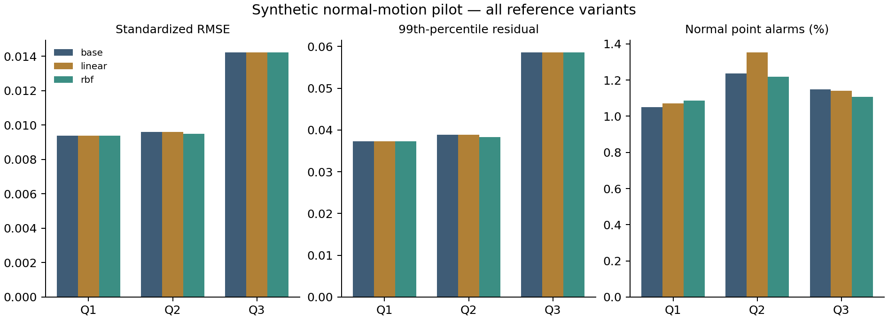

# Candidate-model pilot: measured results

## Material Passport

- Project: manufacturing; operator: Codex at the user’s request.
- Artifact: normal-only candidate-model experiment report, 17 October 2026.
- Evidence: saved synthetic observations and fitted models; no new public dataset or attack outcomes.
- Verification: deterministic prediction replay and independent arithmetic passed; this is not an independent experimental replication.

## Main finding

**The declared all-plant improvement criterion failed.** The RBF correction gives a modest RMSE reduction on Q2 and a smaller one on Q3. Q1 RMSE is slightly worse; Q3 tail error is slightly worse. All 30 fits completed without numerical failure. This supports an implemented candidate and a comparison result, not superiority over CASPER or a validated new detector.

## Prediction and benign alarms

Each row pools 27 episodes and 29,700 eligible observations. RMSE averages squared standardized errors across four channels. q99 is the 99th percentile of the maximum absolute standardized channel residual. Point alarms use the separately calibrated, frozen threshold for each role. Alarm-state occupancy includes persistence and must not be confused with point exceedance.

| Plant | Reference | RMSE | q99 residual | Point alarms /29,700 | Dual-rule alarm-state points /29,700 |
|---|---|---:|---:|---:|---:|
| Q1 | base | 0.00938490 | 0.03731038 | 312 | 3093 |
| Q1 | linear | 0.00937587 | 0.03729009 | 318 | 3151 |
| Q1 | rbf | 0.00938537 | 0.03726135 | 323 | 3171 |
| Q2 | base | 0.00960756 | 0.03885518 | 367 | 2631 |
| Q2 | linear | 0.00961009 | 0.03890446 | 402 | 2945 |
| Q2 | rbf | 0.00949030 | 0.03831034 | 362 | 2574 |
| Q3 | base | 0.01423424 | 0.05853813 | 341 | 2452 |
| Q3 | linear | 0.01423171 | 0.05856657 | 339 | 2430 |
| Q3 | rbf | 0.01421998 | 0.05862629 | 329 | 2267 |

| Plant | RBF RMSE change vs base | RBF q99 change vs base | Declared plant check |
|---|---:|---:|---|
| Q1 | +0.0050% | -0.1314% | fail |
| Q2 | -1.2205% | -1.4022% | pass |
| Q3 | -0.1002% | +0.1506% | fail |

These differences are descriptive. No confidence interval or statistical-significance claim is made. The result is not rescued by reporting only Q2. The base predictor already has small measured error under these settings.

## Model selection

Each plant: 3 training episodes (3,300 eligible targets), 9 development episodes (9,900 targets), 5 calibration episodes (5,500 targets). The partitions are disjoint within this procedure but reused from earlier synthetic development. Training means/scales and coefficients do not use the calibration population. Selection uses the declared development criterion. Calibration uses ascending rank 5,445 of 5,500, with strict exceedance; this does not guarantee 1% future alarms.

| Plant | Selected RBF centers | Width multiplier | Ridge | Selected actual width | Linear ridge |
|---|---:|---:|---:|---:|---:|
| Q1 | 32 | 1.0 | 0.01 | 6.73278985 | 0.01 |
| Q2 | 32 | 0.5 | 0.001 | 3.40291091 | 0.01 |
| Q3 | 32 | 1.0 | 0.001 | 6.81154755 | 0.01 |

All candidates, per-episode development metrics and timing are in `local/residual_twin_v0.13/runs/pilot_001/candidates.json`. The selected settings are best within the declared search, not globally optimal. Every selected RBF has 132 output coefficients plus 640 center coordinates and 40 feature normalization values; the ARX state and parameters are additional.

## Return-rule diagnostics

| Plant | Reference | Point evidence | Long evidence | Dual evidence | Dual evidence-availability probes |
|---|---|---:|---:|---:|---:|
| Q1 | base | 29700 | 28620 | 28620 | 108/108 |
| Q1 | linear | 29700 | 28620 | 28620 | 108/108 |
| Q1 | rbf | 29700 | 28620 | 28620 | 108/108 |
| Q2 | base | 29693 | 28620 | 28620 | 108/108 |
| Q2 | linear | 29693 | 28620 | 28620 | 108/108 |
| Q2 | rbf | 29693 | 28620 | 28620 | 108/108 |
| Q3 | base | 29671 | 28620 | 28620 | 108/108 |
| Q3 | linear | 29672 | 28620 | 28620 | 108/108 |
| Q3 | rbf | 29673 | 28620 | 28620 | 108/108 |

The denominator is 29,700 scored endpoints. Long/dual evidence can first exist at index 140, excluding 40 additional points per episode; 28,620 is their maximum evidence count. Every role reaches that maximum here. Consequently these normal checks do not demonstrate a return-evidence advantage for the nonlinear model. The probe is only evidence availability; see [reporting clarifications](REPORTING_NOTES.md). No attacked recovery, premature clear or attack F1 was measured.

## Validation and resource use

- 18 synthetic software tests passed, including training-only fitting, causal prediction, save/reload, nonfinite channels and missing-context gate behavior.
- 4,080 saved-artifact checks passed in a fresh process, including full post-initialization measurement perturbation, all 243 reference outcomes and independent window/metric arithmetic.
- One supervised attempt: 16.115 s wall, 15.189 s worker CPU, 53.23 MiB sampled peak RSS, 22.15 MiB monitored output. Limits: 120 s / 90 s / 1 GiB / 50 MiB. RSS sampling is not an instantaneous ceiling.
- The sandbox denied the `/bin/ps` preflight. The scoped launcher ran with approved process-monitor access; no experiment failed or was retried. A later status read looked for `stdout.log`, but the supervisor uses `worker.log`; that failed read did not change the experiment.
- All configurations, seeds, commands, dependencies, old/current source hashes, input identities, selection/score seals, logs and failures are retained. No CASPER observations, new attack slice, external upload or system-package change occurred.

## Statistical and interpretation audit

| Check | Finding / handling |
|---|---|
| Simpson reversal | Plant-level results are visible; no pooled claim substitutes for the failed all-plant criterion. Task/condition descriptive outcomes remain in outcomes.json. |
| Ecological inference | No claim about other robots, tasks or individual attacks. |
| Selection/Berkson bias | Finite normal synthetic settings; not a sample of industrial deployments. |
| Collider bias | No post-outcome filtering; all 81 episodes and 30 fits retained. |
| Base rates | All episodes are normal. Attack precision, recall and F1 are undefined here. |
| Regression to mean | Paired same-observation controls reported; reused development acknowledged. |
| Survivorship | Zero failed fits; all required outcomes present. |
| Look-elsewhere | Full grid preserved and primary failure retained; no significance search. |
| Forking paths | Scientific plan/code frozen before fitting and fresh generation; reporting clarifications explicit. |
| Causal scope | Controlled software comparison only; no causal claim about real industrial security. |
| Reverse causality | Training/selection/calibration precede fresh generation; no test-to-model update path. |

11/11 categories considered using the research skill guidance. These are same-assistant checks, not external peer review. Three paired noise seeds do not constitute 81 independent robots or replications.

## Decision

Keep this as a measured candidate and preserve the simple controls. Do not advance its nonlinear correction as a proven contribution or begin a confirmatory attack campaign under an improvement claim. The next model-design decision should be driven by a demonstrable failure mode and a distinguishable mechanism, with a new version and fresh evaluation conditions. The implemented reference and gate provide concrete material for the teacher’s proposed-model discussion; their existence does not settle novelty or journal readiness.

## Reproduction commands

From `/Users/matrixusman/CUI/DigitalTwin`:

```sh
manufacturing/.venv-reproduction-v02/bin/python manufacturing/research_cycles/residual_twin_v0.13/freeze.py
manufacturing/.venv-reproduction-v02/bin/python manufacturing/research_cycles/residual_twin_v0.13/run.py
manufacturing/.venv-reproduction-v02/bin/python manufacturing/research_cycles/residual_twin_v0.13/verify.py
manufacturing/.venv-plots-v03/bin/python manufacturing/research_cycles/residual_twin_v0.13/present.py
```

The freeze, run and verification commands refuse to overwrite completed artifacts. Reproduction belongs in a separate authorized copy/version; do not delete the consumed run to repeat it.


