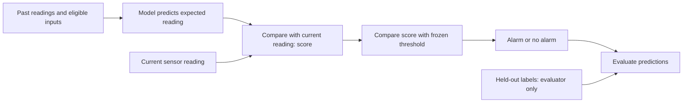

# Step 0: Understand our water-security research

Prepared 16 October 2026. This is an **assistant-prepared teaching lesson**, not a manuscript or evidence that the researcher has read or mastered the material. Every numerical example below is **synthetic**, invented for teaching; none comes from SWaT/WADI or a trained model. No dataset access is needed for this lesson.

Our candidate question in everyday language is: **Can a computer model learn that the plant has legitimately changed without also learning an attack as normal?** The mechanism and novelty remain open. First understand how measurements become alarms and how we test whether those alarms are useful.

## 1. The plant, its measurements and its controller

Imagine a water tank with an inlet pump and an outlet valve. Water enters and leaves; the level changes.

| Term | Meaning | Tank example |
|---|---|---|
| Physical process | What happens in the actual equipment | Water flowing into and out of a tank |
| Sensor | Instrument that measures something | A level sensor reports 1.08 metres |
| Actuator | Device that changes the process | A pump or motor-operated valve |
| Controller | Logic that decides control actions; a PLC is a programmable logic controller | Request the inlet pump to start when level is low |
| Command | An instruction to an actuator | “Pump on” |
| Process state | Quantities describing the process at a time, some potentially unobserved | Actual tank level and other relevant conditions |
| Measurement / telemetry | Recorded information about the process | Timestamped level, flow and pump-status readings |
| Label | An annotation used to evaluate a detector | An interval documented as containing an attack |

A command, a reported actuator status and the physical action are different things. “Pump on” in a log does not prove that the pump ran or that the log is authentic. A reported level is also not automatically the true level.

The real SWaT testbed has physical treatment stages, PLCs, supervisory systems and a historian that records process data. Our tank is a deliberately simplified teaching example, not its hydraulic model or verified channel schema. [iTrust, official SWaT description](https://www.sutd.edu.sg/itrust/swat/)

## 2. A digital twin and what ours would have to do

A digital twin is a digital representation of an identified real-world counterpart. NIST describes representing an entity and its states and transitions. [NIST IR 8356, February 2025](https://csrc.nist.gov/pubs/ir/8356/final)

For **this project**, we would need to specify the physical process represented, the states or measurements predicted, and how observations keep the model aligned with the process. This is our operational requirement, not a claim that every published definition is identical.

A useful candidate twin could predict the next water level from its current level estimate and the incoming/outgoing flows. It might use physical equations, learned relationships, or both. It does not have to be a 3D animation. A classifier that only outputs “attack” does not establish that we have modelled and synchronized a physical counterpart.

In a **synthetic tank** with constant cross-sectional area, no overflow or leaks, and known constant flows during the interval:

```text
next level = current level + (inflow − outflow) × elapsed time / tank area
           = 1.00 m + (0.02 − 0.01) m³/s × 1 s / 1 m²
           = 1.01 m
```

This is a simplified predictor. Actual benchmark models would need documented inputs, noise assumptions, parameter identification and validation. For our first study, any synchronization would be through chronological replay of recordings; that would not establish a live deployment.

## 3. Prediction → residual → score → threshold → alarm

Now the level sensor reports **1.08 m**, while the prediction made before seeing that reading was **1.01 m**.

1. **Prediction:** the expected reading, 1.01 m.
2. **Residual:** observed minus predicted, `1.08 − 1.01 = +0.07 m`.
3. **Anomaly score:** a number measuring departure from the model's expectations. For this example use the absolute residual, `score = 0.07 m`.
4. **Threshold:** the cutoff for an alarm. Suppose our invented cutoff is `0.05 m`.
5. **Alarm:** since `0.07 > 0.05`, raise an alarm.

Here a larger score means more suspicious. Other methods can use different score definitions and directions; these must be aligned for evaluation. A score is **not automatically a probability**: 0.07 does not mean a 7% chance of attack. Real multichannel scores may scale/combine several residuals and need not have metre units.



For this predictive example, calculate the score **before** assimilating the new reading or using it to learn new normal behaviour. Otherwise the model may absorb the very discrepancy we wanted to detect. An adaptive method can update afterward under its predefined rule, without true test labels.

An alarm establishes a discrepancy under a model and decision rule. It does not by itself establish malicious intent or even a physical change. The same discrepancy could arise from model error, a sensor fault, a legitimate change or an attack. Conversely, a stealthy attack may produce a small score.

| Situation | Meaning | Evidence needed beyond an unusual reading |
|---|---|---|
| Anomaly | A departure from expected behaviour | Defined expectation and score; cause may remain unknown |
| Physical fault | Equipment malfunction | Maintenance records or independently documented fault scenario |
| Cyberattack | Deliberate malicious interference | Documented attack scenario and timing, plus relevant evidence |
| Legitimate operating change | Authorized change in demand, setpoint or mode | Operating records and a justified normal-change annotation |

A dataset-wide attack label may cover an event interval; it does not mean every channel is manipulated throughout that interval. Anomaly detection and supervised attack classification also differ: learning normal patterns is not the same information access as training on labelled attack examples.

## 4. A baseline is our comparison, not our new idea

A **baseline** is a reference method against which we compare an approach. It can be an existing detector or a simple, well-defined control. A baseline paper describes a method; its code implements that method; its published score is a reported measurement under its own protocol. These are not interchangeable.

For this project, CAROTS is a conditional non-twin comparison. A fixed twin could test whether adaptation helps at all; an ungated adaptive twin could test whether accepting every update causes contamination. The three collected papers remain a learning set, not three approved numerical baselines. Read the [audit verdict](BASELINE_VERIFICATION_REPORT.md) before relying on their claims.

An **ablation** changes or removes one component of our own method while keeping the comparison controlled. Removing the proposed update gate would help test the gate's contribution. One variant can serve as both a baseline and an ablation, depending on its role.

Fair comparison means the same eligible data, information access, score coverage and evaluation rules. It does **not** mean using an identical numerical threshold for methods with different score scales. Each can receive its own threshold under the same declared calibration rule.

## 5. Four data roles: learning, choosing, calibrating and testing

The model and the whole detection procedure can overfit. We therefore separate their development from the final examination.

| Role | What it is for | What we must avoid |
|---|---|---|
| Training | Fit model parameters and training-dependent preprocessing | Fitting normalization on the entire dataset |
| Validation / development | Choose model size, window length, checkpoint and other design options | Calling repeatedly inspected development outcomes a final test |
| Calibration | Set the alarm cutoff using a declared rule on eligible data | Choosing a cutoff that maximizes F1 on held-out attacks |
| Final testing | Measure the frozen method's behaviour on unseen evaluation data | Adjusting the method after seeing these outcomes, then reusing them as untouched confirmation |

For our proposed normal-only development, training, validation and calibration would use designated normal data. Validation could examine prediction error; calibration could set a score quantile for a predeclared false-alarm target. Normal validation alone does not demonstrate attack-detection quality. A quantile chosen on calibration data also does not guarantee that future false-alarm rates stay the same.

**Synthetic split example:** imagine 100 chronological normal observations. Assign 1–60 to training, 61–80 to validation, 81–90 to calibration and 91–100 to held-out normal evaluation. Keep a separate, untouched attack-containing recording for final attack evaluation. These tiny counts are teaching choices, not proposed SWaT/WADI split sizes or sufficient calibration evidence.

Split recordings **before** constructing windows. A window is a short sequence of consecutive observations. With a five-observation window, `[57,58,59,60,61]` crosses the training/validation boundary and is excluded under this example's strict partition rule. Do not shuffle overlapping windows across partitions. Real data also require checks for gaps, event boundaries and distribution differences; chronology alone is not sufficient.

## 6. Data leakage: accidentally using the exam to design the answer

**Leakage** occurs when information unavailable to the intended method or reserved for evaluation influences development. It is not limited to placing test rows in a training file. Using test results to choose thresholds, preprocessing or preferred variants can bias the evaluation even when model weights never change. Security-ML research documents data snooping, biased parameter selection and inappropriate comparisons as methodological pitfalls. [Arp et al., USENIX Security 2022, methodological background](https://www.usenix.org/system/files/sec22-arp.pdf)

Examples specific to our proposed protocol:

- Trying ten thresholds on held-out attack labels and keeping the one with the best F1.
- Calculating normalization statistics from training and final-test data together.
- Randomly dividing overlapping time windows so both partitions contain the same measurements.
- Filling a missing online reading using a future observation that would not yet be available.
- Passing true test attack labels to the adaptation gate.
- Looking at baseline test failures, designing our new model around them, and claiming those same attacks are still an untouched final test.

Use training data to fit preprocessing; use independent eligible development/calibration data for choices; freeze the procedure before final scoring. If test results guide a redesign, label that work exploratory and obtain an independent confirmation set where feasible. During a predeclared online replay, using observed past/current measurements for causal adaptation is not automatically leakage; access to future data or hidden labels is the problem.

## 7. What a useful alarm looks like: a worked synthetic example

These four invented test points are a classroom exercise, not data for choosing our future threshold. Suppose `alarm = score > 0.05 m` was fixed beforehand.

| Point | Score (m) | Synthetic truth, evaluator only | Decision | Outcome |
|---|---:|---|---|---|
| A | 0.01 | Normal | No alarm | True negative (TN) |
| B | 0.06 | Normal | Alarm | False positive (FP): false alarm |
| C | 0.07 | Attack | Alarm | True positive (TP): detected attack point |
| D | 0.03 | Attack | No alarm | False negative (FN): missed attack point |

We have one of each outcome:

- **Precision:** `TP / (TP + FP) = 1/2`. Half the alarmed points actually belong to attacks.
- **Recall:** `TP / (TP + FN) = 1/2`. Half the attack points were alarmed.
- **F1:** `2 × precision × recall / (precision + recall) = 0.5`.
- **Pointwise false-positive rate:** `FP / (FP + TN) = 1/2`. Half the normal points were alarmed.

FPR is not generally `1 − precision`: its denominator is all normal points, not all alarmed points. They happen to coincide at this threshold in this tiny example.

For a **fixed classroom illustration**, compare three cutoffs on those same invented scores:

| Threshold (m); alarm if score is greater | TP | FP | FN | TN | Precision | Recall |
|---|---:|---:|---:|---:|---:|---:|
| 0.020 | 2 | 1 | 0 | 1 | 2/3 | 1 |
| 0.050 | 1 | 1 | 1 | 1 | 1/2 | 1/2 |
| 0.065 | 1 | 0 | 1 | 2 | 1 | 1/2 |

With fixed scores, lowering the threshold cannot reduce the number of alarms; raising it cannot increase them. Performance need not change at every threshold movement. This demonstrates the trade-off, **not a rule to select the best test cutoff**. Our actual thresholds must be set without held-out attack outcomes.

Later we also need **event recall** (how many documented attack intervals were detected), **detection delay** (time from attack onset to the first eligible alarm), and false-alarm burden on normal operation. Count missed events explicitly rather than hiding them by averaging delays only over successes. A point, a continuous alarm episode and an attack event are different counting units.

## 8. Why adaptation creates our research problem

A legitimate increase in demand can change expected operation. A rigid model may then alarm unnecessarily. An adaptive model may learn the changed behaviour and reduce those alarms. But if it learns from corrupted measurements, it may also make an attack appear normal.

Three updates have different meanings:

| Update | Tank interpretation |
|---|---|
| State estimate | “I now estimate the level to be 1.02 m.” |
| Model parameters | “I revise the learned relationship between pump action and flow.” |
| Residual calibration / threshold | “I change how much prediction error I tolerate before alarming.” |

A fixed-parameter twin can still update its state estimate. An adaptive threshold changes detection even if the prediction model is unchanged. We must specify exactly which update a proposed **trust gate** accepts, delays or rejects.

The gate would use evidence available at that time, potentially process consistency or disagreement with a reference model. It cannot consult true attack labels during evaluation. Low scores do not prove a window is clean, and recorded actuator values are not automatically independent trustworthy evidence. Some legitimate changes and attacks may be indistinguishable with the available observations. Whether a gate improves this trade-off is the research question, not an established result.

## 9. Your explanation and next reading

Use [your note scaffold](../papers/notes/research_basics.md) to explain the ideas in your own words. These prompts are for discussion, not a scored examination:

1. In the tank example, distinguish the sensor reading, prediction, score and threshold. What does the alarm establish, and what does it not establish?
2. Why does choosing a threshold after seeing test attack labels invalidate an untouched-test claim, even if the model is unchanged?
3. How would a baseline and an ablation help evaluate a proposed update gate?
4. If an adaptive model learns a forged reading as normal, what has gone wrong? What may the gate use, and what must it never use?

Completion means you can explain these ideas and the data flow yourself. Preparing this lesson does not tick your reading or understanding tasks. Exact provider channel identification under W0.03 remains a separate source/schema task. After discussing your explanation, study CAROTS's inputs, outputs, score and threshold path before its detailed network architecture. No new training or implementation is part of this step.

Optional vocabulary as it arises: a **release** is a specific dataset version; a **feature/channel** is one measured or recorded variable; a **hyperparameter** is a design setting such as window length; a **checkpoint** stores model state; a **seed** controls a source of randomness but does not by itself guarantee reproducibility; a **reimplementation** is our code based on a method description.

Source scope: NIST supports the broad twin concept; iTrust supports the real testbed context; Arp et al. supports methodological background. These are not three new detector baselines. All tank arithmetic, classroom splits, score examples and teaching scenarios are our synthetic constructions. The research skill's source-verification and experiment-planning guidance informed the explanation; no full research pipeline, formal review or empirical experiment was executed.
